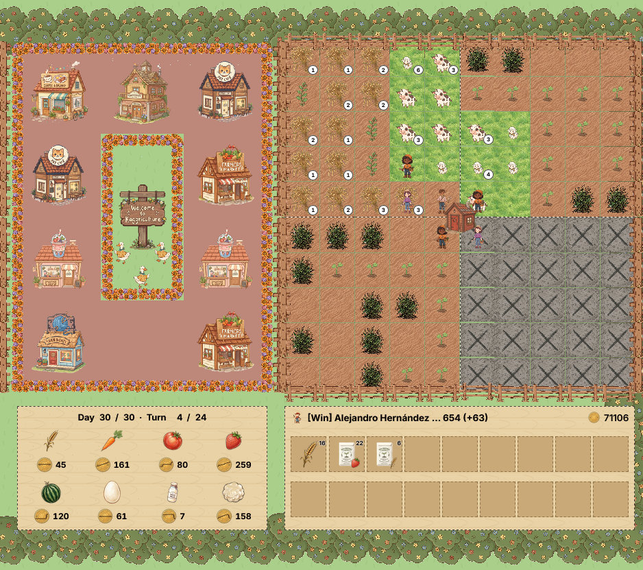

# Kaggriculture Agent

A rule-based agent that plays a two-player farming simulation: it plants and
sells crops, hires and routes farm hands, buys land, raises animals, and trades
on a market shared with the opponent, over a 720-turn season.

Built for Kaggle's [Kaggriculture](https://www.kaggle.com/competitions/kaggriculture)
featured simulation competition (2026), closed 2026-09-30.

**Project site with the full write-up, charts and the "what worked / what
didn't" analysis:** https://alherma7.github.io/AI-agent-Kaggriculture/



| | |
|---|---|
| **Final leaderboard** | **rank #6448** of 10,148 teams, score **3155.0** (1st: 5890.3), 13 submissions |
| Local benchmark (final agent) | **111,603** mean final money over 8 paired seeds, up from 3,343 for the first agent in a real game |
| Real ladder games | 3.3k → 5.7k → 6.1k → 6.7k → 31.3k → 47.3k final money across six analyzed episodes, ending in a 71,106-money win |
| Active period | 2026-08-05 → 2026-09-03 (stopped 4 weeks before the close) |

The final rank is reported as it is: the agent kept improving locally, but the
top of the field moved faster. The project site explains why: every top-7 team
trained a neural policy on public replays, while this agent hand-codes its rules.

## The final agent

1. **Crop calendar.** Melon for days 0–9, while the market still pays its high
   base price. Wheat afterwards, as the replanted staple. Carrot as a one-off
   batch. Strawberry (an ongoing crop) on dedicated tiles.
2. **Units on fixed routes.** The farmer walks a closed 12-tile loop, sized to
   the ~12 tiles a unit can tend in a 24-turn day. Up to 9 hands are hired in one
   batch each morning. Each hand has a private, disjoint zone, so hands never
   pile onto the same tile.
3. **Land.** The NE quadrant is bought as soon as it is affordable (around day 7)
   and worked by *extra* hands, so the home quadrant never loses coverage.
4. **Animals as chain hands.** Three hands each walk a closed circuit of
   pastures, 14 tiles in total. On each shed trip a hand picks up one unit of
   wheat per pasture, then builds, places, feeds, cares for and harvests along
   the circuit. Animals are bought only when there is room to place them.
5. **Market.** Sells go first in the order list, ahead of buys, because the
   engine processes both players' orders in lockstep and every sale lowers the
   price. The whole shed is sold at once. A wheat floor keeps the herd fed.

## What I built and found

- **An incremental, gated development process.** 15 notebooks, one increment
  each. Every change had to beat the previous best before the next started, and
  every result is logged in [`PROGRESS.md`](PROGRESS.md), the negative ones
  included.
- **Submission tooling.** [`scripts/build_agent.py`](scripts/build_agent.py)
  parses the strategy source with Python's `ast` module (without running it)
  and writes it, with every helper and constant it uses, into a single flat
  `agent/main.py`. It has 29 unit tests, plus a check that the committed file
  matches the generated one. Twice it caught a missing dependency right before
  a submission would have crashed.
- **Replay analysis.** Real ladder episodes, both ours and top players', were
  turned into action-count and day-by-day timelines. These drove the roadmap
  and exposed bugs: hands merging onto one tile, an unvisited loop tile, a
  quadrant hands walked before it was bought.
- **Silent-failure hunting.** [`scripts/replay_guard.py`](scripts/replay_guard.py)
  flags actions the engine accepts but ignores, and timing milestones that
  drift. The engine source served as ground truth over the docs.

## What worked and what didn't

The three largest gains were **game mechanics the agent was getting wrong, not
strategy**:

- **Bulk wheat pickup: +47k mean money.** The agent picked up wheat one unit
  per shed trip instead of one per pasture.
- **Sells before buys: +7k.** SELL orders sat behind up to nine buys in the
  market list. The 4th-place team found the same mechanic only after the
  deadline.
- **Batched hiring: +7k.** A stale `if/elif` chain hired one hand per turn.

All three were measured on paired 8-seed A/B tests, improving all 8 seeds. They
were found by instrumenting episodes turn by turn, never by reading code.

Rejected on the numbers:

- copying a top replay's day-6 land purchase (−22.6k);
- a third quadrant plus 12 hands (59.2k → 48.2k);
- buying land by relocating existing hands (lost 20/20);
- harvesting late to squeeze the watering bonus (the plants rot into weeds).

Full tables, the lessons, what I never tried and a side-by-side comparison
with the 3rd, 4th and 7th place solutions are on
[the project site](https://alherma7.github.io/AI-agent-Kaggriculture/).

## Repository layout

```
agent/main.py     generated submission file (never hand-edited)
src/              graduated strategies (strategies/baseline.py) + evaluate.py harness
scripts/          build_agent.py (strategy -> flat agent/main.py), replay_guard.py
notebooks/        01-15, the full experimental record, one increment per notebook
tests/            pytest unit tests for the strategies and the build script
docs/
  index.html      project site: results, final agent, what worked/didn't, lessons
  GAME_RULES.md   the competition's game rules (crop/animal tables, market, turn order)
  RULES_SUMMARY.md  competition rules that constrain the submission
PROGRESS.md       full dated development log (every increment, gate, bug, rejected idea)
RESOURCES.md      engine-mechanics notes and every source consulted
```

## Data and rules

This repository contains code, notebooks and aggregate results only. Replay
files downloaded from Kaggle are git-ignored. The game rules are in
[`docs/GAME_RULES.md`](docs/GAME_RULES.md). The constraints the competition
rules put on the submission are in [`docs/RULES_SUMMARY.md`](docs/RULES_SUMMARY.md).
